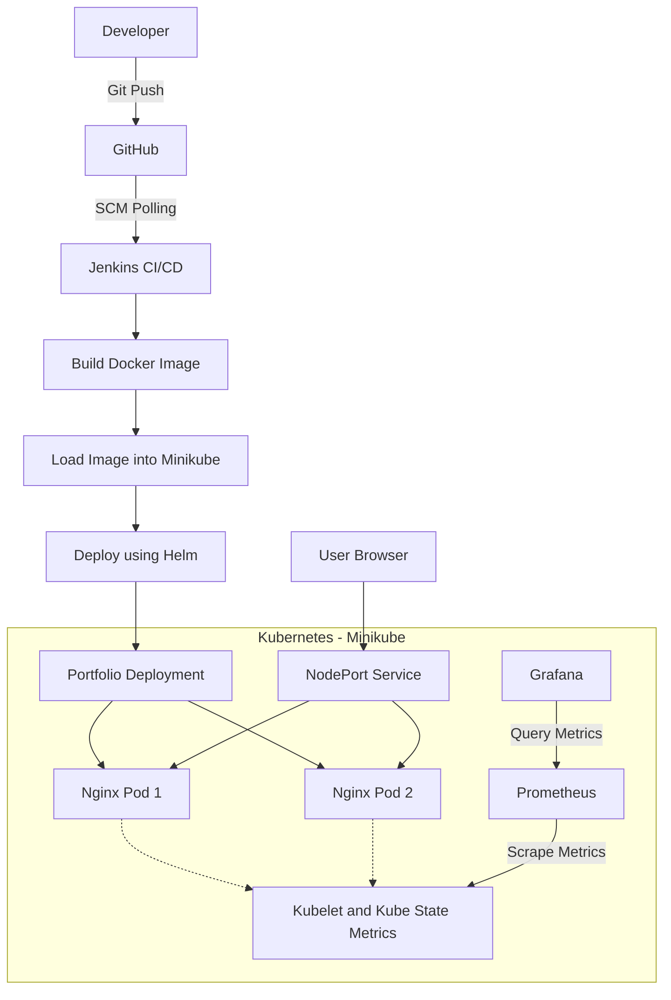
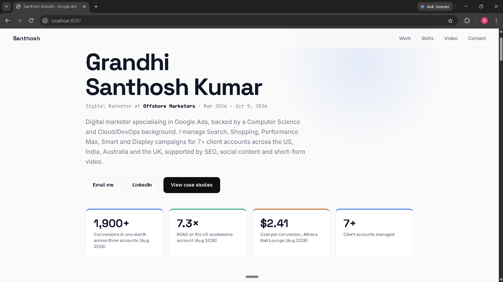
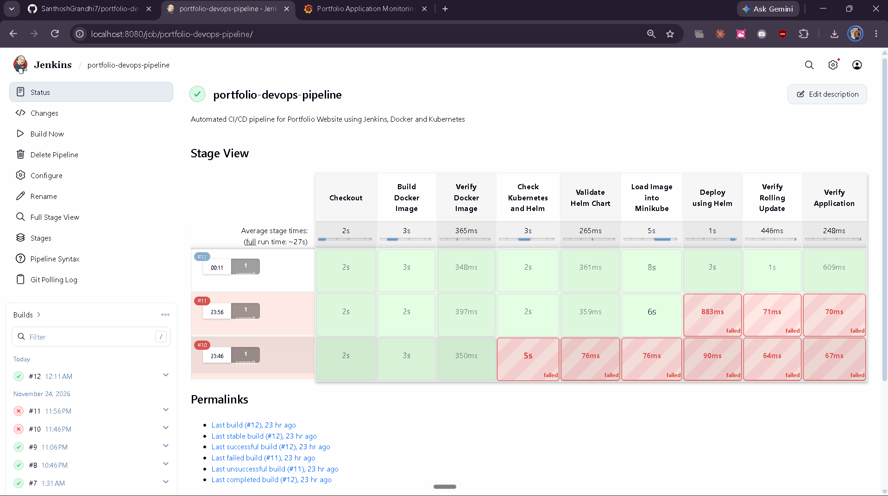
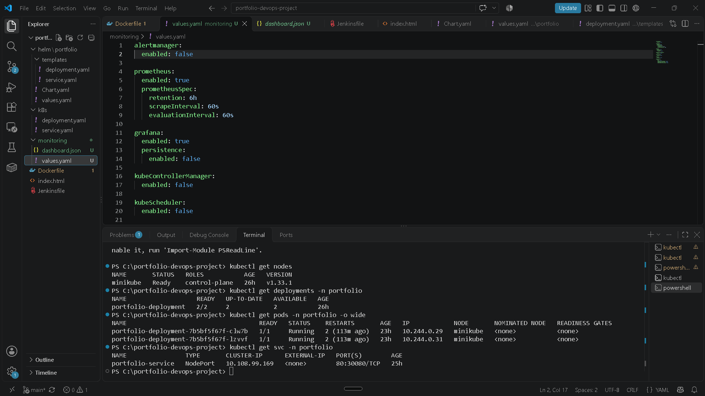
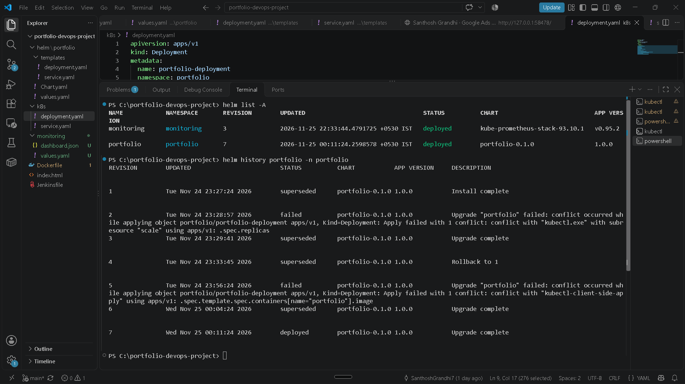
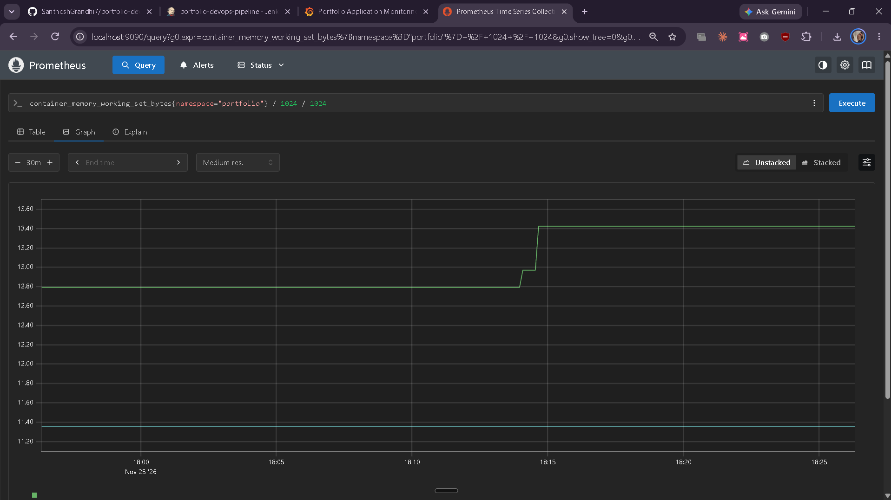
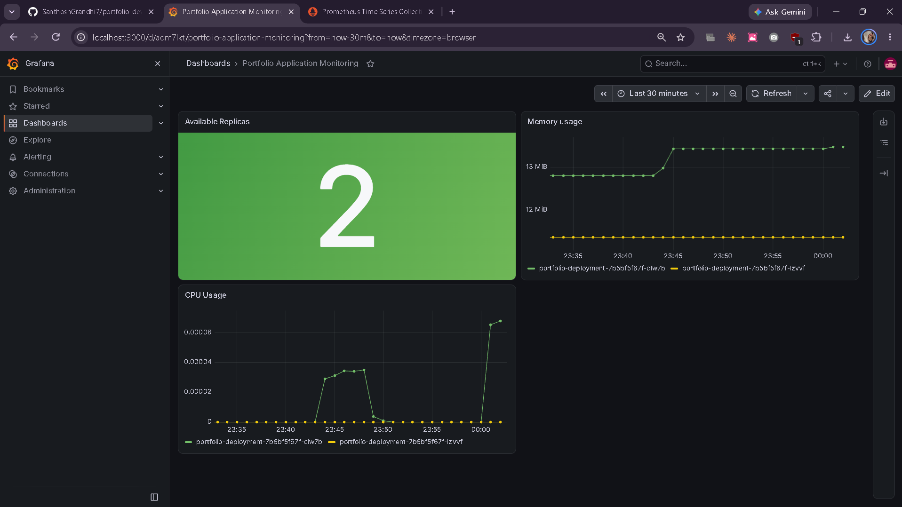

# Automated CI/CD Pipeline with Kubernetes & Monitoring

## Project Overview

A hands-on DevOps project demonstrating automated building, deployment, and monitoring of a containerized portfolio website using Jenkins, Docker, Kubernetes, Helm, Prometheus, and Grafana.

The project runs in a local Minikube environment and demonstrates the complete application delivery workflow, from source code management to application monitoring.

## Technology Stack

| Technology | Purpose |
|------------|---------|
| Git & GitHub | Version control and source code management |
| Docker | Application containerization |
| Nginx | Web server |
| Jenkins | CI/CD automation |
| Kubernetes | Container orchestration |
| Minikube | Local Kubernetes environment |
| Helm | Kubernetes package and release management |
| Prometheus | Metrics collection |
| Grafana | Monitoring and visualization |

## Project Architecture



## Key Features

- Automated CI/CD pipeline using Jenkins.
- Automatic build triggering through Git SCM polling.
- Dockerized portfolio website served using Nginx.
- Kubernetes deployment with two application replicas.
- Kubernetes service-based load balancing.
- Pod self-healing and manual scaling.
- Helm-based deployments, upgrades, and rollbacks.
- Automated rolling update and application verification.
- Kubernetes metrics collection using Prometheus.
- Custom Grafana dashboard for CPU, memory, and replica monitoring.
- Version-controlled infrastructure and monitoring configurations.

## CI/CD Pipeline Workflow

The Jenkins pipeline consists of nine stages:

1. Checkout source code from GitHub.
2. Build the Docker image.
3. Verify the Docker image.
4. Check Kubernetes and Helm availability.
5. Validate the Helm chart.
6. Load the Docker image into Minikube.
7. Deploy the application using Helm.
8. Verify the Kubernetes rolling update.
9. Verify application accessibility.

Each pipeline build generates a versioned Docker image using the Jenkins build number.

## Project Structure

```text
portfolio-devops-project/
├── helm/
│   └── portfolio/
│       ├── Chart.yaml
│       ├── values.yaml
│       └── templates/
│           ├── deployment.yaml
│           └── service.yaml
├── k8s/
│   ├── deployment.yaml
│   └── service.yaml
├── monitoring/
│   ├── values.yaml
│   └── dashboard.json
├── screenshots/
│   ├── portfolio-website.png
│   ├── jenkins-pipeline.png
│   ├── kubernetes-pods.png
│   ├── helm-releases.png
│   ├── prometheus-metrics.png
│   └── grafana-dashboard.png
├── Dockerfile
├── Jenkinsfile
├── index.html
└── README.md
```

The `k8s` directory contains the initial Kubernetes manifests. 
The automated pipeline uses the Helm chart for deployment.

## Prerequisites

- Git
- Docker Desktop
- Jenkins
- Java
- Minikube
- kubectl
- Helm

The project was implemented in a Windows-based local development environment.

## Application Deployment

### 1. Clone the Repository

```bash
git clone https://github.com/SanthoshGrandhi7/portfolio-devops-project.git
cd portfolio-devops-project
```

### 2. Start Minikube

```bash
minikube start --driver=docker --cpus=2 --memory=3072
```

### 3. Create the Application Namespace

```bash
kubectl create namespace portfolio
```

### 4. Build the Docker Image

```bash
docker build -t portfolio-devops:v1 .
```

### 5. Load the Image into Minikube

```bash
minikube image load portfolio-devops:v1
```

### 6. Deploy Using Helm

```bash
helm upgrade --install portfolio ./helm/portfolio -n portfolio --set-string image.tag=v1 --wait
```

### 7. Verify the Deployment

```bash
kubectl get deployments -n portfolio
kubectl get pods -n portfolio
kubectl get svc -n portfolio
```

### 8. Access the Application

```bash
kubectl port-forward -n portfolio svc/portfolio-service 8087:80
```

Open `http://localhost:8087` in a browser.

## Jenkins CI/CD Configuration

- Create a Jenkins Pipeline job.
- Configure the GitHub repository as the SCM source.
- Select Pipeline script from SCM.
- Set the script path to `Jenkinsfile`.
- Enable Poll SCM using `H/5 * * * *`.
- Ensure Jenkins has access to Docker, Minikube, kubectl, and Helm.
- Run the initial build.

Subsequent source code changes are automatically detected through SCM polling.

The Jenkinsfile uses local Windows paths for Minikube, kubeconfig, and Helm. These paths must be adjusted when running the pipeline on another machine.

## Monitoring Setup

Prometheus and Grafana are deployed using the 
kube-prometheus-stack Helm chart in a separate monitoring namespace.

```bash
helm repo add prometheus-community https://prometheus-community.github.io/helm-charts
helm repo update
kubectl create namespace monitoring
```

Install the monitoring stack:

```bash
helm upgrade --install monitoring prometheus-community/kube-prometheus-stack --version 93.10.1 -n monitoring -f monitoring/values.yaml --wait --timeout 10m
```

Verify the monitoring components:

```bash
kubectl get pods -n monitoring
```

### Access Prometheus

```bash
kubectl port-forward -n monitoring svc/monitoring-kube-prometheus-prometheus 9090:9090
```

URL: `http://localhost:9090`

### Access Grafana

In a separate terminal:

```bash
kubectl port-forward -n monitoring svc/monitoring-grafana 3000:80
```

URL: `http://localhost:3000`

Retrieve the Grafana admin password using PowerShell:

```powershell
[System.Text.Encoding]::UTF8.GetString([System.Convert]::FromBase64String((kubectl get secret monitoring-grafana -n monitoring -o jsonpath='{.data.admin-password}')))
```

Import the exported `monitoring/dashboard.json` file into a compatible Grafana instance and configure the Prometheus data source if required.

## Grafana Dashboard

A custom dashboard named **Portfolio Application Monitoring** was created to visualize application health and resource consumption.

### Available Replicas

```promql
kube_deployment_status_replicas_available{namespace="portfolio",deployment="portfolio-deployment"}
```

### Memory Usage (MiB)

```promql
container_memory_working_set_bytes{namespace="portfolio",container="",pod!=""} / 1024 / 1024
```

### CPU Usage (Cores)

```promql
rate(container_cpu_usage_seconds_total{namespace="portfolio",container="",pod!=""}[5m])
```

The replica panel uses visual thresholds to indicate deployment health:

- Green: Two or more available replicas.
- Red: Fewer than two available replicas.

## Project Screenshots

### Portfolio Website



### Jenkins CI/CD Pipeline



### Kubernetes Deployment and Services



### Helm Release Management



### Prometheus Metrics



### Grafana Monitoring Dashboard



## Challenges and Troubleshooting

During implementation, several practical DevOps issues were identified and resolved:

- Jenkins access to the local Kubernetes environment.
- Helm executable availability within the Jenkins environment.
- Kubernetes resource ownership conflicts during Helm upgrades.
- Container registry DNS and image download failures.
- Monitoring stack installation timeouts.
- Missing metrics in the default Grafana dashboards.

A custom Grafana dashboard was created using verified PromQL queries to visualize the available portfolio metrics.

## Project Outcomes

- Successfully automated application building and deployment.
- Deployed a containerized application with two Kubernetes replicas.
- Demonstrated scaling, self-healing, and service-based load balancing.
- Implemented Helm upgrades and rollbacks.
- Integrated Prometheus and Grafana for application monitoring.
- Verified successful CI/CD execution following a GitHub commit.

## Project Scope

This project is designed for hands-on DevOps learning using a local Kubernetes environment.

No paid cloud infrastructure is required. Grafana persistence and Alertmanager are disabled to keep the monitoring setup lightweight. The dashboard configuration is exported for backup.

## Author

Santhosh Grandhi

B.Tech - Computer Science and Engineering
| Cloud & DevOps